  <a href="https://elimmeka.com">elimmeka.com</a> · <a href="mailto:rachid.fofana@elimmeka.com">rachid.fofana@elimmeka.com</a> · Ouagadougou, Burkina Faso

Cartes dessinées par un script Python depuis l'API GitHub, rafraîchies chaque matin par GitHub Actions.

